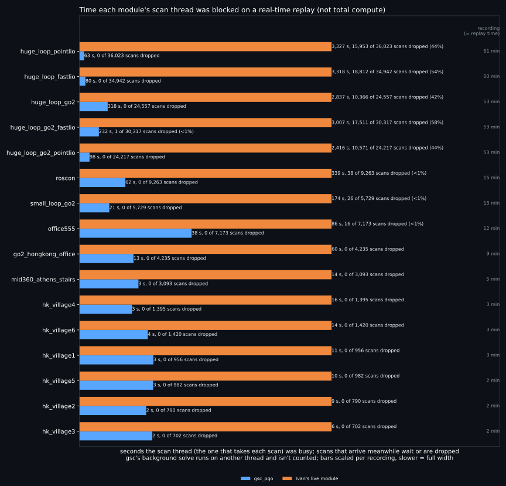

# eval_loop: gsc_pgo vs Ivan's go2 PGO, replayed live

Both PGOs get the same recordings, replayed in real time through their live code paths, and the same
scoring.

- **gsc_pgo**: `pgo-eval` (`gsc_pgo/rust/src/eval.rs`). Scans arrive at their recorded
  times. Each closure goes to the background GNC worker and its result is adopted when it lands, in the
  live module's order (`main.rs`). It skips a keyframe's loop search while newer scans are already waiting,
  and the queue holds `max_scan_queue` (5) scans and drops the oldest past that. Defaults are `gsc_pgo/module.py`'s, checked on every run.
- **Ivan's live module**: `ivan_live.py`, his `PGOMap` at `PGOVoxelMapper`'s defaults
  (`dimos/navigation/go2/loop_closure/`). One frame at a time, keeping only the newest scan that arrived
  meanwhile (his `backpressure`). It builds the global map every 5 frames, as `unitree-go2-pgo` runs it.
- Scans are read and decoded on a separate thread in both, as each module receives them off its
  transport.
- Machine: a laptop with an i7-13620H (16 threads, Ubuntu 24.04, 30 GB), otherwise idle, one replay at a time.

## Metrics

- **loops**: closures in the final graph (gsc: GNC weight above 0).
- **voxels**: occupied 0.2 m voxels of the corrected map vs raw odometry. Lower means duplicate walls
  merged. Noise floor: a rigid 10 cm shift of a raw go2 map moves it by up to 7% (villages) and 17%
  (office).
- **tags**: AprilTag spread (Ivan's `eval.py` metric). Per marker, the summed pairwise distance between
  its corrected sightings, in m; lower is tighter. Sightings come from `jnav/utils/apriltags.py`'s gates
  and robust per-visit clustering, timed by the store ts (some recordings' image header stamps are on
  a boot clock).
- **dropped**: scans the module never processed.
- **latency**: from a scan's arrival to the module being done with it, in ms (median / p99 / max).

## Results

**For a general-purpose robot loop closure (outdoors and indoors, an unknown lidar, limited compute,
and a foundation that planners build on), gsc_pgo is the clear choice.** Each point below backs one part of that:

1. **Foundation for other systems: the planner takes corrections as diffs, not as the whole map.** A
   closure moves the map under the MLS planner, and its goal has to move with it. gsc publishes the moved nodes, so the planner patches
   the moved region and carries the goal along. Rebuilding MLS from Ivan's whole map takes 13.2 s median
   (5.5M points), and his module publishes it every 5 frames, 7299 times an hour: 120,090 CPU-s per hour, about 33 cores.
2. **Outdoors, unknown lidar: gsc closes huge loops on high- and low-quality lidars with one config.** Quality-based scan
   rejection and GNC outlier rejection hold on the Mid-360 and on the go2's own lidar without retuning.
   In practice, Ivan's module can't close large loops: its per-scan time grows about 10x over a huge
   loop, and it drops 42-58% of the scans. On the huge loops gsc's tag spread is 1.7-27 m; Ivan's is
   12-840 m.
3. **Indoors and on low-drift recordings, the two tie.** They're within the voxel noise floor, and the tags
   are close, so nothing is given up on the easy cases.
4. **Limited compute: gsc stays responsive and drops almost no work.** Its latency stays flat, and it dropped 1 of the 186,000 scans
   it was sent, on a run that shared the machine with another job. Ivan's module dropped 73,000 of the same scans.
   gsc peaks at about half Ivan's RAM on the Mid-360 huge loops (470-680 MB vs 1.1-1.3 GB). On the go2's own lidar
   it peaks higher (2.6 GB vs 1.7 GB): it keeps every keyframe's cloud, and those scans are 30k points each. Over an hour of huge_loop_pointlio, gsc's scan thread was blocked for 63 s
   (its solve runs on a background thread). Ivan's module does all its work on one thread, which was blocked
   for 3,327 s, 92% of the hour, and still dropped 44% of the scans.

### Scan-thread time per replay: responsiveness, not total compute



`plot_busy.py`. This shows how long each module's scan thread, the one that takes each new scan, was
blocked. While it's busy, new scans wait or are dropped. It is not total compute: gsc hands its GNC
solve and iSAM2 rebuild to a background thread that isn't counted here. Ivan's module does everything,
including rebuilding the global map every 5 frames, on the one thread. That is the point of the chart:
one thread doing all the work is what makes it fall behind and drop scans.

Both modules get the scans at their recorded times, so every replay takes as long as the recording (right
column), whatever the module's speed. A bar runs from each scan's arrival, or the previous scan's finish if
that was later, to its own finish. Bars are scaled per recording, the slower module drawn full width.

### MLS planner cost of following each PGO

`mls_reform/reform_bench.py` on huge_loop_pointlio (1 h, 373 closures, Mac):

| what the planner does | updates/h | wall s/h | CPU s/h | wall ms median / max |
|---|---|---|---|---|
| rebuild from Ivan's whole map, on each of his publishes | 7299 | - | 120,090 (demanded) | 13,199 / 21,597 |
| patch gsc's moved region in place | 197 | 15.2 | 39.0 | 0 / 676 |
| reform gsc's moved region (warp) | 178 | 499.7 | 723.0 | 1,592 / 15,224 |

### Speed (recordings of 20+ min)

`run.py --tables`:

| recording | module | mean ms, first 10 min | mean ms, last 10 min | worst 10-min mean | worst ms | over 100 ms | over 1 s | dropped | RAM MB, start -> peak |
|---|---|---|---|---|---|---|---|---|---|
| huge_loop_pointlio | gsc_pgo | 1 | 3 | 3 | 98 | 0.0% | 0 | 0 | 91 -> 682 |
| huge_loop_pointlio | Ivan's live module | 56 | 258 | 387 | 2852 | 74.8% | 105 | 15953 | 608 -> 1255 |
| huge_loop_fastlio | gsc_pgo | 1 | 4 | 4 | 251 | 0.1% | 0 | 0 | 90 -> 596 |
| huge_loop_fastlio | Ivan's live module | 59 | 302 | 528 | 4107 | 71.3% | 80 | 18812 | 601 -> 1141 |
| huge_loop_go2_pointlio | gsc_pgo | 3 | 9 | 9 | 328 | 0.7% | 0 | 0 | 52 -> 469 |
| huge_loop_go2_pointlio | Ivan's live module | 76 | 437 | 429 | 4248 | 77.0% | 43 | 10571 | 568 -> 1097 |
| huge_loop_go2_fastlio | gsc_pgo | 6 | 23 | 24 | 665 | 3.8% | 0 | 1 | 84 -> 597 |
| huge_loop_go2_fastlio | Ivan's live module | 100 | 601 | 585 | 5409 | 77.8% | 43 | 17511 | 574 -> 1238 |
| huge_loop_go2 | gsc_pgo | 3 | 32 | 33 | 351 | 4.7% | 0 | 0 | 35 -> 2586 |
| huge_loop_go2 | Ivan's live module | 61 | 734 | 724 | 6643 | 68.7% | 100 | 10366 | 570 -> 1683 |

### Loops, maps, tags

`run.py --tables`:

| recording | scans | raw tags | gsc_pgo loops / voxels / tags / dropped / latency | Ivan's live module loops / voxels / tags / dropped / latency |
|---|---|---|---|---|
| small_loop_go2 | 5729 | 0.25 | 37 / -11.3% / 0.28 / 0 / 0/71/241 | 24 / +1.9% / 0.26 / 26 / 28/84/486 |
| huge_loop_go2 | 24557 | 794.73 | 44 / -18.5% / 13.64 / 0 / 0/244/351 | 57 / +1.0% / 684.22 / 10366 / 181/953/6643 |
| huge_loop_go2_pointlio | 24217 | 176.48 | 222 / -13.2% / 3.08 / 0 / 0/86/328 | 48 / +0.0% / 228.33 / 10571 / 199/574/4248 |
| huge_loop_go2_fastlio | 30317 | 865.86 | 194 / -10.6% / 26.59 / 1 / 0/210/665 | 47 / -0.2% / 839.84 / 17511 / 262/736/5409 |
| huge_loop_pointlio | 36023 | 97.15 | 312 / -10.1% / 4.35 / 0 / 0/33/98 | 171 / -9.6% / 11.98 / 15953 / 208/436/2852 |
| huge_loop_fastlio | 34942 | 137.43 | 400 / -15.2% / 1.73 / 0 / 0/50/251 | 106 / -2.1% / 131.46 / 18812 / 235/634/4107 |
| mid360_athens_stairs | 3093 | - | 23 / +0.0% / - / 0 / 0/24/54 | 22 / -0.0% / - / 0 / 4/34/132 |
| roscon | 9263 | - | 18 / +0.5% / - / 0 / 0/131/358 | 13 / -1.0% / - / 38 / 25/101/901 |
| office555 | 7173 | - | 56 / +0.1% / - / 0 / 0/158/347 | 36 / -0.0% / - / 16 / 11/68/382 |
| go2_hongkong_office | 4235 | - | 33 / -5.0% / - / 0 / 0/54/96 | 37 / -3.7% / - / 0 / 13/80/247 |
| hk_village1 | 956 | 4.06 | 16 / +0.1% / 3.70 / 0 / 0/62/85 | 15 / +3.4% / 6.44 / 0 / 8/108/171 |
| hk_village2 | 790 | 21.67 | 4 / +0.7% / 21.72 / 0 / 0/62/100 | 10 / +0.9% / 20.09 / 0 / 8/89/156 |
| hk_village3 | 702 | 4.81 | 11 / +0.7% / 4.61 / 0 / 0/47/66 | 10 / +0.9% / 4.73 / 0 / 6/68/126 |
| hk_village4 | 1395 | 9.40 | 5 / -0.0% / 8.86 / 0 / 0/50/69 | 15 / +0.9% / 6.75 / 0 / 9/70/148 |
| hk_village5 | 982 | 1.28 | 8 / +0.3% / 1.15 / 0 / 0/55/77 | 13 / +0.4% / 1.20 / 0 / 7/67/189 |
| hk_village6 | 1420 | 1.85 | 9 / -0.3% / 1.42 / 0 / 0/55/71 | 20 / -1.4% / 0.81 / 0 / 7/71/194 |

Top-down of a run (raw | corrected, loop closures in green):
`render_loops.py gsc_live <recording>` -> `$EVAL_LOOP_OUT/<recording>.gsc_live.loops.png`.

## Recordings

| recording | source | what it is |
|---|---|---|
| `small_loop_go2` | cloud `outdoor_small_loop_2026-05-28.db.lz4` | go2 onboard lidar, ~13 min outdoor loop that ends where it starts |
| `huge_loop_go2`, `huge_loop_go2_pointlio`, `huge_loop_go2_fastlio` | cloud `mem2.db.lz4` `dbf5283f…` | the go2 on a ~3 km walk (53 min): its own lidar + leg odometry, and its Mid-360 through Point-LIO and FAST-LIO |
| `huge_loop_pointlio`, `huge_loop_fastlio` | cloud `huge_loop_realsense_2026-06-04.db.lz4` | the same walk on a realsense rig with a Mid-360 (~60 min), two odometries |
| `roscon` | local `roscon_setup.mcap` | the ROSCon setup walk, Mid-360 + Point-LIO, 15 min, scans downsampled to 0.2 m |
| `office555` | local `sf_555_office_1.mcap` | the SF 555 office (two floors), Mid-360 + Point-LIO, 12 min, ends where it starts, scans downsampled to 0.2 m |
| `mid360_athens_stairs` | LFS | a 5 min Mid-360 stairwell loop |
| `go2_hongkong_office`, `hk_village1`..`6` | LFS | go2 recordings |

`roscon`, `office555` and `mid360_athens_stairs` were not used while gsc_pgo was developed; the rest
were. `roscon` and `office555` stored their scans undownsampled, so `prep.py` downsamples them to 0.2 m,
Point-LIO's own `filter_size_surf`. The local ones are the `.mcap`'s lidar, odometry and tf copied into a
`.db`:

```bash
dtk data to_db <recording>.mcap ~/.cache/dimos/eval_loop/<name>.db --map /pointlio_lidar=pointlio_lidar \
  --map /pointlio_odometry=pointlio_odometry --map /tf=tf --map /tf_static=tf_static --trim-to-odom
```

## Limits

- Each number is one replay. Live results depend on the machine, so they move between runs.
- Tags back the comparison only on recordings with AprilTags (2-16 tag visits each).
- The voxel count can drop while a map gets worse, so check the top-downs.
- In the huge-loop cloud db, the FAST-LIO streams, `camera_info` and `tf` were rewritten after
  recording. The Point-LIO streams were generated offline from the pcap. Both PGOs get the same inputs.

## Reproduce

```bash
# 1. gsc_pgo's replay binary (needs nix: the crate's flake brings gtsam)
(cd dimos/navigation/jnav/components/loop_closure/gsc_pgo/rust && nix develop path:. --command cargo build --release --bin pgo-eval)

# 2. python env + a console.dimensional.org login (for the cloud recordings)
uv sync && source .venv/bin/activate
dimos login

cd dimos/navigation/jnav/components/loop_closure/eval_loop
python run.py                    # every recording: download, prep, replay both live, print the table
python run.py <recording> ...    # just these
python run.py --tables           # reprint the table
```

Data: cloud recordings go to `~/.cache/dimos/eval_loop/` (`EVAL_LOOP_DATA`), LFS ones to `data/`, and
results to `./eval_loop_results/` (`EVAL_LOOP_OUT`). The binary is
`gsc_pgo/rust/target/release/pgo-eval` (`PGO_EVAL`). The AprilTag visits are cached as
`<recording>.markers.json`, so a machine that has those files doesn't need the camera recordings.
