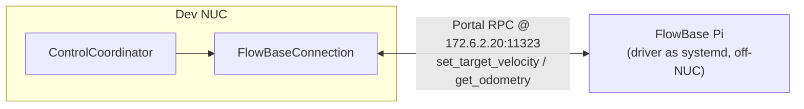

# FlowBase

Holonomic base control over Portal RPC. `FlowBaseConnection`
([connection.py](connection.py)) lives here; the driver runs on the i2rt base.

## External system



The base driver is off-NUC. The dev NUC runs the ControlCoordinator and
`FlowBaseConnection`, which speaks Portal RPC to the Pi.

## 1. FlowBase driver

The driver (`flow_base_controller_modified.py`) runs on the FlowBase Pi as
a **systemd service** and starts automatically on boot. No SSH needed for
normal operation — it exposes a Portal RPC server on `172.6.2.20:11323`
(`set_target_velocity`, `get_odometry`) the moment the Pi is powered up.

To debug or restart the service:

```bash
ssh i2rt@172.6.2.20
systemctl --user status flow_base_controller    # check it's running
systemctl --user restart flow_base_controller   # restart
journalctl --user -u flow_base_controller -f    # tail logs
```

A `No joystick/gamepad connected` line in the logs is normal — RPC works
without a gamepad.

Verify reachability from your dev machine:

```bash
nc -vz 172.6.2.20 11323
```

## 2. Launch

Two blueprints:

```bash
# Coordinator only (drive /cmd_vel from another source)
dimos run coordinator-flowbase

# Coordinator + WASD pygame teleop
dimos run coordinator-flowbase-keyboard-teleop
```

Both run `FlowBaseConnection` against `172.6.2.20:11323`. Twist comes in on
`cmd_vel`; `odometry` and `coordinator_joint_state` go out.

### Blueprint notes

- **`coordinator-flowbase-keyboard-teleop`** opens a small pygame window —
  **focus that window** to drive. Controls: W/S forward-back · Q/E strafe ·
  A/D turn · Shift boost (to 0.8 m/s) · Ctrl slow · Space stop · ESC quit.
- **`coordinator-flowbase`** is just the bare driver; you publish `/cmd_vel`
  from somewhere else.

## Notes

- Joints: `base/base_forward`, `base/base_lateral` (m/s, up to 0.8) and
  `base/base_turn` (rad/s, up to 3.0), the limits of the base's firmware.
  A faster command is refused.
- Frame convention: FlowBase uses inverted Y/yaw. The connection negates
  `vy` and `wz` before sending, and `y` and yaw of the odometry it reads,
  so commands in and odometry out are standard ROS frame.
- Address override: `--flowbaseconnection.address host:port` after the
  blueprint name. Blueprints are in
  [mobile.py](../../control/blueprints/mobile.py).
