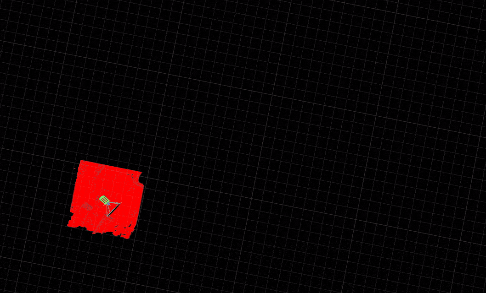

# Go2 Navigation Overview

The Go2 navigation stack uses a simple **column-carving voxel map** strategy: each new LiDAR frame replaces the corresponding region of the global map entirely, ensuring the map always reflects the latest observations. Map live as you drive, or return to a known space using a saved premap and relocalization.

## go2

| Workflow                    | When to use                                                            | Blueprint                    | Docs                                                               |
|-----------------------------|------------------------------------------------------------------------|------------------------------|--------------------------------------------------------------------|
| **Live mapping**            | Explore a new space, mapping live as you drive                         | `unitree-go2`                | [Navigation deep dive](/docs/capabilities/navigation/deep_dive.md) |
| **Premap**                  | Return to a known space and relocalize against a saved map             | `unitree-go2`                | [Go2 mapping and relocalization](/docs/capabilities/navigation/go2/index.md) |

For hardware setup, simulation, and the full blueprint list, see the [Go2 platform guide](/docs/platforms/quadruped/go2/index.md).

## Generic

| Workflow                 | When to use                                                            | Blueprint     | Docs                                                |
|--------------------------|------------------------------------------------------------------------|---------------|-----------------------------------------------------|
| **Simulation, no robot** | Run the raycaster and planner against a photoreal scan of a real house | `habitat-nav` | [Habitat](/docs/capabilities/navigation/habitat.md) |
