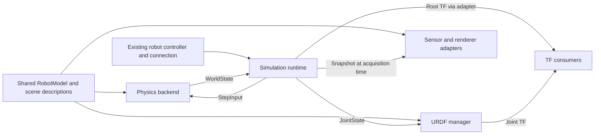

# sim2 core handoff for Jeff

**Proposed contract for review; not implemented by the current PR.** Keep the
working G1 application as the integration test. Extract a small physics core:
**one world state, one complete input per physics step, one backend interface.**
Extend the existing shared model and URDF manager for model identity, frames
and attachments. Do not make the physics loop depend on live TF or manager RPCs.

## The ownership boundary



| Owner | Owns | Does not own |
| --- | --- | --- |
| Shared model layer, extended with Jeff | Canonical body/joint IDs, topology, axes, units, limits, geometry, inertia and named fixed frames | Live simulation state or stepping |
| `UrdfManager` | Robot TF publication and model/asset distribution | Contact solving, command expiry or sensor acquisition |
| sim2 core | Physical body/joint state, applied inputs, step/reset ordering and overload behavior | Another robot model, mount registry or TF tree |
| Backend adapter | Model compilation, engine handles, integration, native actuator/force conversion | Robot policy, task reward or Desktop behavior |
| Sensor, renderer and robot adapters | Acquisition, images/clouds, hardware motor ordering, policy feedback, renderer-specific assets | Redefining the robot's mounted frames |

The existing [RobotModel](/dimos/robot/assets/model.py) already resolves URDF/Xacro,
canonical joint renames, topology, model variants and `with_fixed_frame()`.
[UrdfManager](/dimos/robot/urdf_manager.py) already publishes fixed/scalar joint
transforms and serves assets. Typed link/inertia/collision/sensor catalogs would
be extensions; they are not already exposed by `LoadedRobotModel`.

## Exact physical state

Reuse DimOS `Pose` and `Twist`. No separate robot-shaped copy, IMU, camera frame,
mesh, task reward or engine checkpoint in this state.

```python
from collections.abc import Mapping
from dataclasses import dataclass
from typing import Literal, Protocol
from uuid import UUID

from dimos.msgs.geometry_msgs.Pose import Pose
from dimos.msgs.geometry_msgs.Twist import Twist
from dimos.msgs.sensor_msgs.MotorCommandArray import MotorCommandArray

Vec3 = tuple[float, float, float]
Quat = tuple[float, float, float, float]  # xyzw, unit quaternion
DriveKind = Literal["pd_effort", "native_position"]


@dataclass(frozen=True)
class StateId:
    epoch: UUID  # new on build/reset; old-run inputs cannot be reused
    tick: int   # completed public steps in this epoch; starts at zero


@dataclass(frozen=True)
class BodyState:
    pose: Pose    # world pose of the authored body/link origin
    twist: Twist  # world-expressed velocities AT THAT SAME ORIGIN


@dataclass(frozen=True)
class ScalarJointState:
    position: float                  # rad for hinge, m for slider
    velocity: float                  # rad/s or m/s
    actuator_effort: float | None     # Nm or N, final internal integration step


@dataclass(frozen=True)
class BallJointState:
    orientation: Quat                 # child joint frame in parent joint frame
    angular_velocity: Vec3            # relative velocity, in CHILD joint axes
    actuator_torque: Vec3 | None       # Nm, same axes


@dataclass(frozen=True)
class WorldState:
    id: StateId
    sim_time: float                   # seconds since this epoch began
    model_revision: str              # identifies the shared compiled description
    bodies: Mapping[str, BodyState]
    joints: Mapping[str, ScalarJointState | BallJointState]
```

| Question | Contract |
| --- | --- |
| What is an object? | An application grouping of physical bodies. A box has one body; G1 has many. Physics addresses bodies, not an additional object-pose copy. |
| What is a joint? | A constraint between bodies. Its coordinates describe allowed relative motion. A joint does not imply a motor. |
| Which frames appear in state? | Physical body/link frames. Optical frames and sensor mounts resolve through the shared model. |
| Floating and fixed joints? | Free-root motion is already in `BodyState`. Fixed joints are topology only. Neither needs another dynamic joint-state entry. |
| Effort meaning? | Actual actuator contribution used by the final internal integration step, after native transmission/limits; excludes contacts, constraint reactions, passive forces and external wrenches. Not a whole-step average. `None` on initial/reset state or when unavailable, never an invented zero. |
| Joint coordinates? | Shared model zero/sign/axis and SI units, not SDK array order or encoder scaling. Ball rotation includes the authored joint-frame convention. |
| Snapshot ownership? | Every field is from the same completed step; copied values must not alias mutable engine memory. |
| Is this a save file? | No. Solver warm starts, actuator internal state and engine checkpoints remain backend-specific. |

Wall-clock receive/publication times belong in transport/runtime diagnostics.
They must not replace `sim_time` or drive policy observation history.

## Exact inputs and backend boundary

Keep the distinction the current G1 profiles already need: GR00T commands PD
motors; stock G1 uses authored position servos. The current `JointDrive` hides
that distinction behind fields which some actuators reject.

```python
@dataclass(frozen=True)
class JointInfo:
    kind: Literal["revolute", "prismatic", "spherical", "fixed"]
    drive: DriveKind | None  # None means no supported one-to-one scalar drive


@dataclass(frozen=True)
class WorldDescription:
    model_revision: str
    step_dt: float  # one public step in simulated seconds; fixed while loaded
    bodies: Mapping[str, Literal["dynamic", "static", "kinematic"]]
    joints: Mapping[str, JointInfo]
    # IDs refer to the shared model; no second copy of origins, axes or mounts.


@dataclass(frozen=True)
class JointPD:
    joint: str
    position: float
    velocity: float
    kp: float
    kd: float
    feedforward: float


@dataclass(frozen=True)
class JointPosition:
    joint: str
    position: float  # native servo retains authored gains and dynamics


@dataclass(frozen=True)
class BodyWrench:
    body: str
    force_world: Vec3 = (0.0, 0.0, 0.0)
    torque_world: Vec3 = (0.0, 0.0, 0.0)
    point_world: Vec3 | None = None  # None means the body's current CoM


@dataclass(frozen=True)
class StepInput:
    from_state: StateId
    drives: tuple[JointPD | JointPosition, ...]
    wrenches: tuple[BodyWrench, ...] = ()


class PhysicsBackend(Protocol):
    # Factory configures the backend with model instances before build().
    def build(self) -> WorldDescription: ...
    def read_state(self) -> WorldState: ...
    def step(self, inputs: StepInput) -> WorldState: ...
    def reset(self) -> WorldState: ...
    def close(self) -> None: ...
```

- `step()` validates the entire input before changing state. `from_state` must
  match the current epoch/tick. Success advances exactly `step_dt` and returns
  tick + 1. Invalid input changes nothing. All vectors must be finite.
- Every declared driven joint gets exactly one correctly typed drive per step.
  The runtime expands held targets and fallback behavior explicitly. Missing,
  duplicate or unsupported drives are errors; no backend chooses an implicit hold.
- For `pd_effort`, compute desired effort `kp*(q_target-q) + kd*(dq_target-dq) + feedforward`
  each integration step, with nonnegative gains. Apply through the declared
  actuator/transmission, retaining its limits and dynamics. A native position
  servo accepts `JointPosition` instead. Unsupported transmissions fail at build.
- Wrenches last one public step and add. `point_world` is an absolute world point;
  its contribution about the CoM is `(point_world - com_world) × force_world`.
  `torque_world` is an additional pure couple. Only dynamic bodies accept wrenches.
  With internal substeps, the world point stays fixed and the moment arm is
  recomputed against the moving CoM on each internal step.
- World coordinates keep TF lookup outside the backend. A caller can resolve a
  body- or sensor-relative push using the shared frame definition and this state.
- `reset()` restores the configured initial state, with a new epoch, tick 0 and
  time 0. It preserves model/topology. Model changes require rebuild/new revision.
  Pausing is a runtime operation: do not step or advance simulation time.

No separate `apply_force()` call followed by an unrelated `step()`: the inputs
and the interval they affect stay together. Kinematic pose scripting, contact
queries, native checkpoints and robosuite task actions/rewards are optional
interfaces beside this core. They are not mandatory backend methods.

## The actual G1 case

The example consumes a complete command from the existing 29-motor GR00T path.
`motor_joint_ids` is the connection adapter's motor-order mapping into shared
model IDs; it is resolved once, not another robot definition. This scene has
G1, a free box and a passive hinged door, with no other driven joints.

```python
def step_g1_scene(
    backend: PhysicsBackend,
    state: WorldState,
    motor_joint_ids: tuple[str, ...],
    command: MotorCommandArray,
) -> WorldState:
    assert len(motor_joint_ids) == command.num_joints == 29
    drives = tuple(
        JointPD(joint, q, dq, kp, kd, tau)
        for joint, q, dq, kp, kd, tau in zip(
            motor_joint_ids, command.q, command.dq,
            command.kp, command.kd, command.tau, strict=True,
        )
    )
    return backend.step(StepInput(
        from_state=state.id,
        drives=drives,
        wrenches=(
            BodyWrench("box", force_world=(20.0, 0.0, 0.0)),
            BodyWrench("door", torque_world=(0.0, 0.0, 3.0)),
        ),
    ))
```

Both wrenches affect this step only. Calling again without them removes them;
a 100 ms push is repeated for 100 ms of **simulation** time by the runtime.
Read G1's resulting pose in `next_state.bodies["g1/pelvis"]`, its joints by
canonical joint ID, and the door angle from its hinge's `ScalarJointState`.
The door receives a physical torque on its body and the hinge constrains its
motion. It does not need a fictional actuator or a special object-control API.

Stock G1 uses `JointPosition` for its declared native servos. One G1 connection
remains; the control profile and model's declared drive type determine this
translation. Arbitrary generalized effort on an unactuated joint would be a
separate, explicitly defined capability, not a renamed `JointPD`.

## What Jeff can extend

Resolve a mount once from the shared model into **physical body ID + fixed
body-to-frame transform**. At acquisition time, compose it with that body's
pose in the corresponding `WorldState`. This is the boundary; no second sim
mount authoring syntax is needed. The pure model API can be used in-process by
backends and sensors; the live URDF manager publishes compatibility TF/assets.

| Already exists | Extension to agree with Jeff |
| --- | --- |
| `RobotModel.with_fixed_frame()`, joint topology/names and URDF asset resolution | Typed links, inertia/collision/visual catalogs, instance-scoped IDs and frame lookup |
| `UrdfManager` scalar/fixed TF and asset serving | Shared frame attachments, clear partial-state validity and multi-instance handling |
| Root pose provided separately; manager skips floating/planar joints | One owner per TF edge; authoritative sim root plus joint state projected to standard messages |
| Sensor-specific measurement configs | Reference shared mount IDs; keep intrinsics, scan pattern, noise and acquisition clocks in sensor/device configs |

The manager currently substitutes zero for absent joint positions. That is not
an acceptable source of authoritative physics state without an explicit
partial-state policy. Likewise, physics ground truth must not invent a
`world -> odom` alignment for a localization estimate.

For a robot with a working DimOS connection, the target is **one shared model
registration, zero new sim connection modules, zero repeated mount transforms**.
Backend-generated assets are outputs, not a second authored robot. The current
G1 stock/GR00T plants still differ; a canonical model plus named physics/control
profiles must preserve their trained dynamics before those native assets can be
retired. Moving mounts alone does not solve that remaining model duplication.

## Review findings and extraction order

| Current implementation | Core decision |
| --- | --- |
| `WorldState.robots` duplicates joints/base and embeds IMU | Project standard robot feedback in an adapter; remove from core state |
| `PhysicsBackend` requires visuals, checkpoints and task reward/action APIs | Five-method physics lifecycle; optional consumers/adapters own those APIs |
| `JointDescription.actuated: bool` and overloaded `JointDrive` | Explicit drive kind and typed PD/position commands |
| Omitted position servo holds in MuJoCo but becomes zero-force in Genesis | Complete per-step inputs; backend omission semantics disappear |
| `Mount`, `VisualAttachment`, G1 TF constants and camera frame resolution overlap | Shared model owns authored frame definitions; retain only native compilation in adapters |
| Robot timeout uses wall time, generic command duration uses sim time; publishing holds the command/physics lock | Runtime owns clock/freshness/expiry, queues input at step boundaries and publishes outside the owner critical section |

The [idle-jolt evidence](/docs/development/sim2-idle-jolts.md) makes timing a core
acceptance criterion. Record each effective `StepInput`, the originating control
sample, expiry/fallback decision and resulting tick; actual actuator effort is
feedback, not an echo of the requested value. Under overload, explicitly paced
simulation/control steps should slow together. Retain a separately defined
wall-clock connection-loss policy; do not silently turn a scheduling stall into
unexplained motor-gain changes.

Suggested extraction, without replacing the working demo first:

1. Agree this contract and the shared-model/frame ownership boundary with Jeff.
2. Extract `physics.py`, `runtime.py` and the thin DimOS `module.py`; keep native
   model import and solver code inside each backend. Move task, sensor and
   renderer APIs out of the required protocol rather than deleting their working features.
3. Use the existing full G1 stock and GR00T profiles as conformance cases: all
   driven joints, free-root pose/twist, a push on the pelvis/box, a passive door,
   reset/stale-input rejection and deliberate CPU overload. Verify MuJoCo and
   Genesis against the same units/step semantics; do not require identical trajectories.
4. Jeff can then extend the shared model/frame catalog against these fixed IDs
   and state semantics, and adapters can migrate without changing the core API.

Sources: [current physics contract](/dimos/sim2/physics.py),
[runtime](/dimos/sim2/world/runtime.py), [MuJoCo backend](/dimos/sim2/backends/mujoco.py),
[Genesis backend](/dimos/sim2/backends/genesis.py), [G1 model profiles](/dimos/robot/unitree/g1/model.py),
[shared model](/dimos/robot/assets/model.py), [URDF manager](/dimos/robot/urdf_manager.py).
