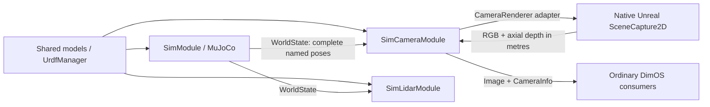

# G1 in the SF555 office

This branch builds on sim2 stack PR #5041 (`4f3d4df90efadf1f0a24ddb65e5b570caa1251bb`).
It adds `unitree-g1-sim2-sf555`: the existing G1/GR00T policy, MuJoCo dynamics,
standard IMU/encoder/lidar streams, and a native Unreal RGB-D camera.
The initial pose is `(16, 1, 0.793)` metres in the saved office's frame, facing +X.
Furniture, the door, and the original robot reference models are static.

## Ownership and camera integration



Unreal is a rendering process, not another physics owner. Imported map actors
have Chaos simulation disabled. Robot geometry loads once from the shared URDF;
each acquisition applies a complete pose snapshot and the optical camera pose.
The office's native materials, lights, Nanite assets, and post-process volumes
stay in the saved level. The renderer rejects mismatched model revisions,
incomplete poses, and movement of the fixed authored environment.

This replaces the earlier standalone `UnrealCameraModule` integration with a
`CameraRenderer` implementation used by the existing `SimCameraModule`.
Scheduling, dropped-frame behavior, timestamps, and image publication therefore
stay in the common sensor module. No new DimOS message types are introduced.

The native bridge uses `USceneCaptureComponent2D`, explicit `CaptureScene()`,
persistent rendering state, and a calibrated custom projection matrix. Colour
capture explicitly enables temporal AA and overrides its GI/reflection methods
to Lumen: UE 5.7 scene captures otherwise override the project defaults to None.
Depth remains an unfiltered geometry capture. The colour capture keeps
history between acquisitions and cuts history when the simulation clock/epoch
changes. The earlier renderer disabled Lumen/reflections and discarded the view
state on every capture; this project enables the scene's rendering features.
See [Epic's SceneCapture API](https://dev.epicgames.com/documentation/en-us/unreal-engine/API/Runtime/Engine/USceneCaptureComponent)
and [CaptureScene](https://dev.epicgames.com/documentation/en-us/unreal-engine/API/Runtime/Engine/USceneCaptureComponent2D/CaptureScene).

GPU readback is asynchronous inside the independent camera process. A compute
pass packs RGB and depth into one buffer, and `FRHIGPUBufferReadback` maps it only
after its GPU fence is ready. This avoids UE 5.7 Metal's unconditional GPU-idle
wait in texture staging maps. One pending capture owns its snapshot identity,
and another request cannot change the scene until its result has been sent.
Completed replies are sent in the same game tick. The unused player viewport
is disabled so only sensor views render; camera Lumen, reflections, and temporal
AA stay enabled. Physics does not wait for the camera.

Rendering features available on the host GPU still determine whether Lumen uses
software or hardware tracing. URDF robot visuals currently use diffuse colors;
native office materials retain their textures.

Wire protocol v2 echoes clock ID, epoch, source ID, sequence, nanoseconds, and
model revision as strings, preserving full int64 counters through Unreal JSON.
RGB and depth come from the same pose snapshot. Depth uses Unreal's SceneDepth
semantics: transparent glass is not automatically an opaque depth surface.
Sensor stop interrupts native startup/capture and reaps only its owned process.

The pending USD-manager change is not assumed here: this uses the current
stack's shared models and SceneConfig. When that change lands, model acquisition
can move to the manager RPC without adding scene ownership to the policy or
making Unreal part of the physics backend.

## Prepare the local assets on macOS

Requires an installed Unreal Engine 5.7 with Xcode, Blender, and the existing
`sf-555-office` project. The provided importer targets its saved V24 Office map.
Private office assets and generated binaries stay outside Git. Nothing edits
the original office project or recording.

From this worktree:

```bash
uv sync --extra sim-unreal --extra control --extra cpu --group dev
export DIMOS_SF555_ASSETS="$HOME/.cache/dimos/sf555"
export SF555_SOURCE="$HOME/Desktop/sf-555-office"
export UNREAL_ENGINE_DIR="/Users/Shared/Epic Games/UE_5.7"

/Applications/Blender.app/Contents/MacOS/Blender \
  --background "$SF555_SOURCE/models/sf555_office_v24_timber_reference.blend" \
  --python "$PWD/dimos/sim2/scenes/sf555/export_blender.py" -- \
  "$SF555_SOURCE/exports/unreal-v24/scene.json" "$DIMOS_SF555_ASSETS/source-meshes"

uv run python -m dimos.sim2.scenes.sf555.prepare_collision \
  --source "$DIMOS_SF555_ASSETS/source-meshes" --output "$DIMOS_SF555_ASSETS"

uv run python -m dimos.sim2.scenes.sf555.prepare_unreal \
  --source "$SF555_SOURCE" --output "$DIMOS_SF555_ASSETS" --engine "$UNREAL_ENGINE_DIR"
```

`prepare_unreal` creates and builds a separate `DimosRenderer` project containing
copied native office content. Rendering settings are copied from the office;
unrelated project service settings are not. Source hashes bind the physics
export to the same Blender revision used for the native map. Re-prepare both
sides after editing the source scene; manually edited native maps need a matching
physics export before use.

`DIMOS_UNREAL_PROJECT` and `DIMOS_UNREAL_EXECUTABLE` override the renderer project
and executable paths. The defaults select the prepared project and the standard
local UE 5.7 macOS editor. Runtime uses `UnrealEditor -game`, not editor Python.
Editor Python is used only to prepare the material asset. Packaging is available
through `native/unreal/DimosRenderer/Scripts/build_macos.sh`; this task validates
the editor's native game runtime.

## Run and verify

```bash
uv run dimos run unitree-g1-sim2-sf555

# Bounded end-to-end run: waits for sensors, walks forward for 4 simulated
# seconds, writes evidence, then stops every module and its Unreal process.
uv run python -m dimos.sim2.scenes.sf555.demo_walk

# Compare collision surfaces with the source's 45 support and 9 doorway probes.
uv run python -m dimos.sim2.scenes.sf555.demo_geometry --assets "$DIMOS_SF555_ASSETS"

# Calibrate the actual native renderer with asymmetric/off-centre intrinsics.
uv run python -m dimos.sim2.sensors.camera.renderers.unreal.demo_calibration \
  --executable "$UNREAL_ENGINE_DIR/Engine/Binaries/Mac/UnrealEditor.app/Contents/MacOS/UnrealEditor" \
  --project "$DIMOS_SF555_ASSETS/DimosRenderer/DimosRenderer.uproject" \
  --output "$DIMOS_SF555_ASSETS/validation/calibration"
```

The blueprint publishes `color_image`, `depth_image`, `camera_info`, `lidar`,
`imu`, and `joint_state`. `G1PolicyModule.move(Twist(...), duration=...)` is the
existing RPC for commanding base velocity. It does not add a navigation planner
or certify autonomous stair/course traversal. The renderer runs offscreen;
view its ordinary image stream in a DimOS consumer. Validation saves a camera
PNG and JSON measurements under `$DIMOS_SF555_ASSETS/validation`.

## Geometry ledger and approximations

The environment is one fixed link, `sf555/world`, with no joints or artificial
inertia. Its right-handed metric frame is the source Blender frame, Z-up. Meshes
are centred locally for numerical precision and placed with explicit URDF
origins. The Unreal boundary alone converts metres to centimetres and reflects Y.
The implicit sim2 ground plane is disabled so it cannot fill authored recesses.

Collision export starts from the 14,484 individual source objects, not a convex
hull of the merged building. Convex objects stay convex. Sub-10cm details are visual only. Individual concave
furniture components spanning less than 1m use conservative hulls. Larger
concave objects use V-HACD (100k voxels and up to 16 hulls; objects spanning at
least 3m use 400k and up to 64). These are
approximations, not exact triangle collision. Every choice is listed in
`collision-report.json`. Planar or sub-millimetre decorations remain visual only;
query-only flat meshes get a 20-micrometre backing for MuJoCo compilation. The visual triangles are combined into 16 static query meshes to avoid importing
thousands of separate visual assets (each binary STL stays below MuJoCo’s
200,000-face limit). Query scenes omit redundant physical
collision geometry when a body has visuals. The native Unreal visuals are unchanged. `prepare_collision.py:gen_urdf()` is the
source of the generated `office.urdf`.

## Verified on this machine

- Native Unreal 5.7 module compiled; off-centre pinhole calibration returned
  2.4999998m for a surface at 2.5m, while preserving counters above 2^53.
  Consecutive captures with changing poses/epochs and image sizes 201×153,
  317×119, and 200×150 returned the expected 2m, 2.75m, and 2.5m depths.
  RGB channel ordering and far-plane/no-hit values also passed.
- Full office: 10,260 MuJoCo geoms, approximately 13s cold model import;
  all 45 support probes and nine doorway-clearance probes passed.
- Full blueprint with asynchronous readback and explicit Lumen/TAA capture:
  G1 walked 0.60m, with pelvis height 0.743m at the end. 4.102 simulated seconds
  took 4.153 wall seconds. The camera produced 43 frames (10.4fps at 640×480),
  versus 29 frames (about 7fps) with the old synchronous bridge.
- An isolated office capture benchmark (40 frames, first 10 excluded) improved
  from 7.64fps to 10.86fps; median adapter latency fell from 130.9ms to 92.7ms.
  This includes removing the unused player viewport. The configured 15Hz is
  still an acquisition ceiling, not an achieved frame rate.
- Camera, lidar, and physics reported no runtime errors; all workers and the
  owned Unreal process stopped cleanly. The existing control gate rejected 33
  duplicate/out-of-order commands. The camera reported no input drops or gaps;
  lidar input drops and initial gaps are recorded in the saved report.
- 85 sim2 tests passed with native integration tests excluded from that suite;
  the native calibration, static geometry, and full walking checks above ran
  separately. After the asynchronous update, all 39 renderer contract/asset
  tests passed again, as did native calibration and the full walking check.
  Mypy passed for the three changed Python files.

These measurements validate a short flat-floor walk, not traversal of every
stair, obstacle, or room. Evidence is in the local `validation` directory.
