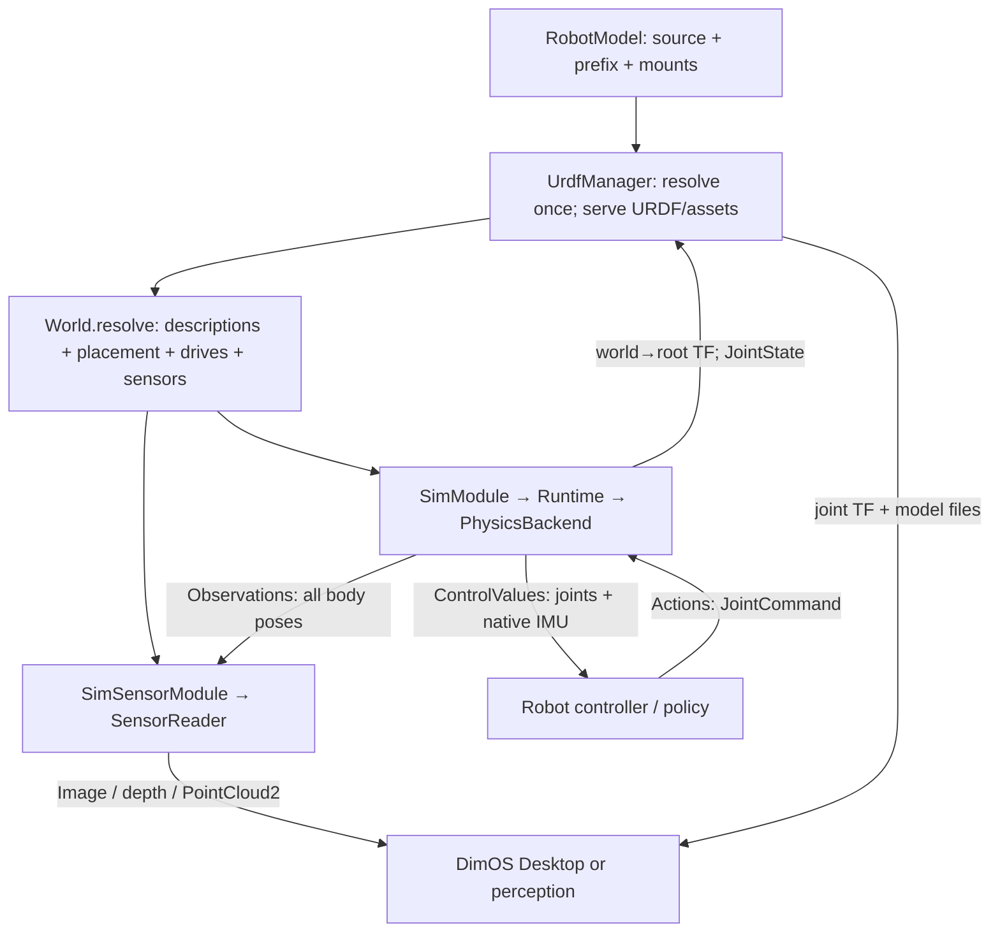

# sim2: descriptions, observations and actions

The physics engine owns the simulation. Other processes receive **absolute body
poses** through generated `sim_msgs.Observations`; camera and lidar do not receive
joint state or a native simulator checkpoint. Every publication is complete,
including stationary bodies. There is no change detection or delta replay.

## The objects and their meanings

| Object | Exact contents and purpose |
|---|---|
| `RobotModel` | Configured source URDF, selected subtree, prefix and fixed mounts. Existing robot asset machinery, also used outside simulation. |
| `LoadedRobotModel` | Resolved URDF text, link/joint description and asset paths. `UrdfManager.resolved_models()` provides this once to consumers. |
| `World` | Named instances with initial placement, floating/fixed roots, drives, sensor profiles and physics timestep. `resolve(models)` binds each instance to the owner's resolved description. |
| `Layout` | Stable body, joint, drive, root and IMU names and their array order; model revision. No changing physical values. |
| `WorldState` | Local physics sample: body poses/twists and joint position/velocity/actuator effort at one epoch/tick. Used inside the owner and by diagnostic `state()` RPC; not broadcast to sensors. Not sufficient to restore solver state. |
| `Observations` | Generated wire message identifying run, model revision, reset epoch, tick, simulation time and wall timestamp, with a list of typed entity observations. |
| `SceneSample` | Validated observation batch as a read-only body-pose array in `Layout.bodies` order. Only input state needed by the camera/lidar query scene. |
| `Actions` | Generated command batch, addressed to run/model/epoch. Its initial kind is `JointCommand`, with named desired position, velocity, kp, kd and feedforward effort arrays. |

An **entity ID is a body/frame name**, such as `robot/hand` or `box`, not a whole
articulated robot and not a joint. A joint names a constrained degree of freedom
between bodies. A pose is world-from-body: XYZ metres and a unit XYZW quaternion,
in a right-handed Z-up world. Articulated links each publish their own pose.



`Observation.POSE` contains the existing generated `geometry_msgs.Pose` encoding.
`Observation.CBOR` is an optional extension with a versioned schema name. It cannot
supply missing poses. Unknown optional kinds can be skipped. Unknown **actions**
reject the entire command batch. See the companion dimos-lcm `docs/sim_messages.md`
for the wire contract and shared Python/TypeScript fixtures.

## Modules and interfaces

| Module / object | Input | Output / methods |
|---|---|---|
| `UrdfManager` | `model=` or named `models=`; `coordinator_joint_state: JointState` | `resolved_models()`; joint TF; requested URDF and referenced files. `name.urdf` selects a named model; legacy requests select the first model. |
| `SimModule` | Configured `world`, backend factory; `actions: Actions` | `observations: Observations`, `robot_feedback: ControlValues`, `joint_state`, native `imu`, root TF. RPCs: `describe`, `describe_world`, `sample`, `state`, `reset`, `place`, `apply_wrench`, `timing`. |
| `SimSensorModule` | Injected `SimulationSpec` for resolved world/layout; `observations`; explicit camera/lidar frame selection | `color_image`, `depth_image`, `camera_info`, `lidar`; `statistics()`. Camera/lidar rates live in `World.sensors`. |
| `Runtime` | Synchronous backend; queued internal targets, efforts and wrenches | `submit`, `prepare`, `advance`, `snapshot`, `capture`, `reset`, `place`. Owns expiry and reset identity; has no transport or renderer. |
| `PhysicsBackend` | Resolved `World` | `layout`, `dt`, `targets`, `efforts`, `hold`, `validate_wrench`, `step`, `snapshot`, `reset`, `place`. MuJoCo is the implemented backend. |
| `SensorReader` | Resolved `World`, `Layout`; generated observations | `observe` → `SceneSample`, `camera(frame, sample)`, `lidar(frame, duration)`, `close`, `gaps`. MuJoCo is the implemented reader. |

Source: [types](/dimos/sim2/types.py), [module](/dimos/sim2/module.py),
[runtime](/dimos/sim2/runtime.py), [observations](/dimos/sim2/observations.py),
[control](/dimos/sim2/control.py), [sensor module](/dimos/sim2/sensor_module.py),
[MuJoCo physics](/dimos/sim2/mujoco.py), [MuJoCo sensors](/dimos/sim2/sensors.py).

The sensor query model flattens geometry-bearing bodies into independently posed
bodies: **zero joints, zero generalized coordinates, zero actuators**. Applying
observations updates each body's world pose. Rendering/raycasting runs in another
worker and never steps dynamics. The cost is per-body pose extraction, encoding,
transport, decoding and geometry updates; this is deliberately not zero-copy.

Robot feedback stays separate because a controller needs joint coordinates and
native IMU measurements, not only geometry poses. `ControlValues` uses named
`joint/position`, `joint/velocity`, `joint/effort`, mounted IMU fields and `sim/time`.
The policy produces `JointCommand`; the backend applies
`tau = kp*(position-q) + kd*(velocity-dq) + effort` each physics tick.

## Time, reset and late readers

A run ID identifies an owner process; model revision identifies its description.
Reset/placement increments an integer epoch, invalidates commands/history and
restarts ticks/time. Compare `(epoch, tick)` only within a bound run/model. Stale
samples are ignored. A new process/model requires rebinding; it is not silently
accepted as a continuation.

`complete=true` means exactly one valid pose per declared body. Readers validate
all of it before replacing their view. A late camera can load `describe_world()`
and `describe()` then render `sample()`, or the next complete publication. It
needs no earlier pose messages. Lidar needs a subsequent full scan interval;
missing history causes a rejected scan, not invented motion. Partial batches are
reserved by the schema but deliberately rejected by the initial reader.

Physics uses fixed 2 ms steps by default. Optional `control_joints` makes the
module wait at publication ticks for a command answering that exact feedback
tick. Slow inference slows simulation time without resetting physics or bursting
through stale commands. Rendering cannot block this loop. This is simulation
pacing, not a physical-robot safety mechanism.

## Minimal runnable core

```bash
source .venv/bin/activate
dimos run sim2-basic --daemon
dimos shell
```

```python
from dimos_lcm.sim_msgs import Action, Actions, JointCommand
from dimos.core.transport_factory import make_transport
from dimos.sim2.types import Wrench

sim = app.SimModule
baseline = sim.sample()
command = JointCommand(n=1, names=["tool_joint"], position=[0.75],
                       velocity=[0.0], kp=[80.0], kd=[8.0], effort=[0.0])
payload = command.lcm_encode()
transport = make_transport("/actions", Actions)
transport.start()
transport.broadcast(None, Actions(
    run_id=baseline.run_id, model_revision=baseline.model_revision,
    epoch=baseline.epoch, tick=-1, ttl=2.0, actions_length=1,
    actions=[Action(kind=Action.JOINT_COMMAND, data_length=len(payload), data=payload)],
))
# Operator intervention, separate from robot commands:
state = sim.reset()
sim.apply_wrench(Wrench(state.epoch, "box", force=(0, 6, 0), duration=0.2))
transport.stop()
```

Open Controller in DimOS Desktop; fixed frame `world`, follow frame `base`.
The pusher demo has no mobile-base policy. Stop with `dimos stop`.

## Verification and scope

```bash
pytest dimos/sim2 dimos/robot/assets/test_model.py
pytest dimos/sim2/test_module.py -m native_e2e
```

Tests cover forces/contact, joint drives/expiry, model resolution, full wire
samples, malformed batches, reset ordering, late readers, RGB/depth/lidar and
actual worker lifecycle. Sensor messages remain normal DimOS messages.

This implementation accepts URDF models with fixed/independent scalar joints.
It does not add MJCF-to-URDF conversion, a second physics backend, dynamic scene
population, automatic real/sim connection replacement or calibrated sensor
realism. Mesh contents are assumed immutable; the model revision hashes resolved
XML/configuration, not the bytes of every referenced asset. Those limits should
be tested explicitly before expanding the contract.
