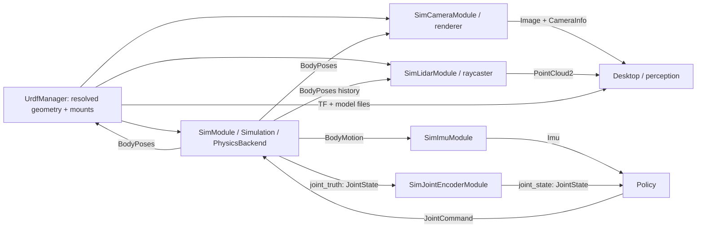

# Sim2: physical truth and independent sensors

A **body** is a rigid frame with a pose. A **joint** constrains motion between
bodies and has a scalar coordinate. A **scene** is the resolved robot/object
geometry plus initial placement and drive parameters. A **measurement** is a
sensor model's output, acquired at a specified time; it is not physical truth.

## Code map

```
sim2/
  description.py              SceneConfig, Instance, Drive; no sensor configuration
  physics/
    interface.py              PhysicsBackend protocol (no MuJoCo types)
    simulation.py             Simulation: clock, steps, command validation/expiry/reset
    module.py                 SimModule: DimOS lifecycle, queues and typed ports
    mujoco.py                 Native dynamics and physical truth queries
  geometry/
    mujoco.py                 Shared model-to-native geometry compiler
    query.py                  Geometry-only scene: no qpos, actuators or stepping
    poses.py                  Complete body-pose validation
  sensors/
    sampling.py               Acquisition cadence and clock/epoch checks
    poses.py                  Bounded camera/lidar worker lifecycle
    imu/module.py             BodyMotion → Imu
    encoder/module.py         Joint truth → measured JointState
    camera/{config,module}.py Camera acquisition and renderer protocol
    camera/renderers/mujoco.py Native camera implementation
    lidar/{config,module}.py  Rolling scan acquisition and raycaster protocol
    lidar/mid360.py           Calibrated four-channel direction pattern
    lidar/raycasters/mujoco.py Native geometry ray queries
```

The existing `robot/assets/RobotModel` defines source geometry, names and fixed
mounts. `UrdfManager.resolved_models()` resolves it once; it also serves the model
and publishes its TF tree. A blueprint passes the **same SceneConfig** to physics
and geometry sensors; each binds it to those resolved descriptions. Sensor settings
are passed to their own modules. No camera or lidar appears in SceneConfig.



## Calls and ports

`SimModule.start()` resolves the scene and creates `Simulation(backend, scene,
timing)`. Its owner thread calls `backend.load()`, then repeatedly processes
commands, exports due truth samples, and calls `backend.step()`. Only this owner
touches native dynamics. Separate publication threads carry queued messages;
rendering and raycasting happen in separate sensor workers.

```python
# PhysicsBackend methods; concrete payloads are generated dimos-lcm types.
load(scene: SceneConfig, dt_ns: int) -> None
read_body_poses() -> list[BodyPose]
read_motion(frame_id: str) -> BodyMotion
read_joints(joint_ids: tuple[str, ...]) -> JointState
set_joint_targets(targets: list[JointTarget]) -> None
step(wrenches: tuple[BodyWrench, ...]) -> None
hold(joint_ids: tuple[str, ...]) -> None
reset() -> None
place(body_id: str, pose: tuple[float, ...]) -> None
close() -> None
```

`SimModule` inputs are `joint_command` and `body_wrench`; outputs are `body_poses`,
`body_motion`, `joint_truth`, and `clock`. RPCs: `inspect(joints=())`, `submit(command)`,
`reset()`, `place(body_id, pose)`, `status()`. `inspect()` returns body poses and the
requested joint sample; it is diagnostic, not a solver checkpoint.

The backend exports kinematic acceleration at the requested origin in world axes.
`SimImuModule.measure()` rotates velocity/acceleration into sensor axes, subtracts
gravity, and applies bias/noise. Ideal orientation is an explicit option, not an
attitude estimator. `SimJointEncoderModule.measure()` selects joints and applies
position offset/quantization/noise. Its velocity channel is explicitly ideal;
effort is unavailable and empty. Both preserve acquisition identity and cache a
repeated acquisition rather than drawing fresh noise.

Camera and lidar get complete body poses, not physics checkpoints. Each creates
its own geometry-only query scene from the same models. Camera intrinsics and
native camera objects belong in `sensors/camera`; lidar pattern, scan timing and
range response belong in `sensors/lidar`. The raycaster only returns intersections.
The MuJoCo camera currently supports a centered, square-pixel pinhole camera.
Mid360 supplies a fitted directional pattern; material response is not modeled.

## Time and failure behavior

Every truth and measurement message has `SampleHeader(clock_id, epoch, time_ns,
source_id, sequence, frame_id)`. Time is acquisition time, never receipt time.
Reset/placement increments epoch and returns simulation time to zero. Joining,
interpolation and recording must never cross epochs or clock IDs.

Physics defaults to 2 ms. Independent schedules export poses at 200 Hz, selected
motion/joints at 500 Hz; sensors choose their own rates. A non-integral period
uses the first actual physics sample at/after its deadline (200 Hz at 2 ms steps:
0, 6, 10, 16, 20 ms), preserving the actual acquisition time.

A configured controller must answer an exact sample boundary. Physics waits there
until its command arrives, with a finite host-time deadline. Expiry/fault never
teleports or resets a robot. Slow rendering drops queued scene samples; a rolling
scan detects insufficient history and drops that scan. High-rate truth queue
overflow is a visible fault rather than silent control data loss. `status()` and
sensor `statistics()` expose failures and counters.

## Run and verify

Requires the companion dimos-lcm draft revision pinned by this branch.

```sh
uv sync --extra sim
source .venv/bin/activate
dimos run sim2-basic --daemon
dimos status
dimos shell
dimos stop
pytest dimos/sim2 -o addopts='' --import-mode=importlib
```

The G1/GR00T example and real asset/policy acceptance test are in the second PR.
The core imports no G1 code and changes no control coordinator. MuJoCo is the
implemented backend; a second backend has not been validated. The native camera
and raycaster are selectable adapters, not a claim of cross-engine fidelity.

### G1 acceptance blueprint (second PR)

```sh
uv sync --extra sim --extra control
source .venv/bin/activate
dimos run unitree-g1-sim2 --daemon
dimos shell
# policy = dimos.get_instance("G1PolicyModule")  # use shell's module discovery
# sim = dimos.get_instance("SimModule")
dimos stop
```

`robot/unitree/g1/blueprints/basic/unitree_g1_sim2.py` composes the shared G1 model,
a desk and box, four independent sensors, and `G1PolicyModule`. The policy joins
IMU/encoder acquisitions by clock/epoch/time at 50 Hz and runs the existing GR00T
ONNX task unchanged. Its typed JointCommand returns through the ordinary stream.
Camera cadence is 15 Hz. The IMU explicitly requests ideal orientation. This
example is not a new hardware connection or control coordinator.
