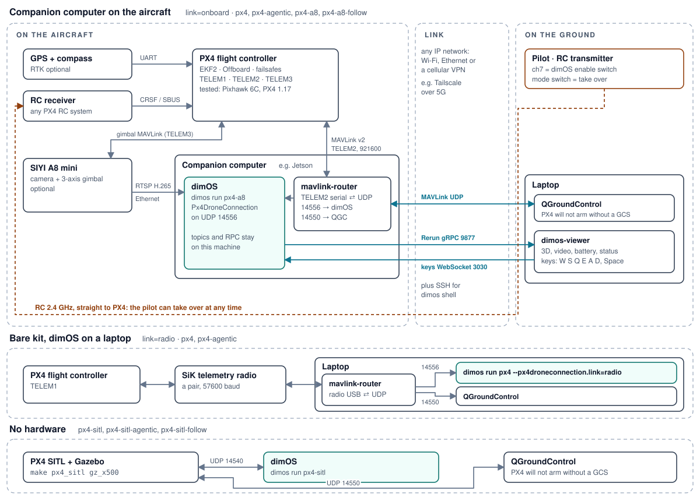
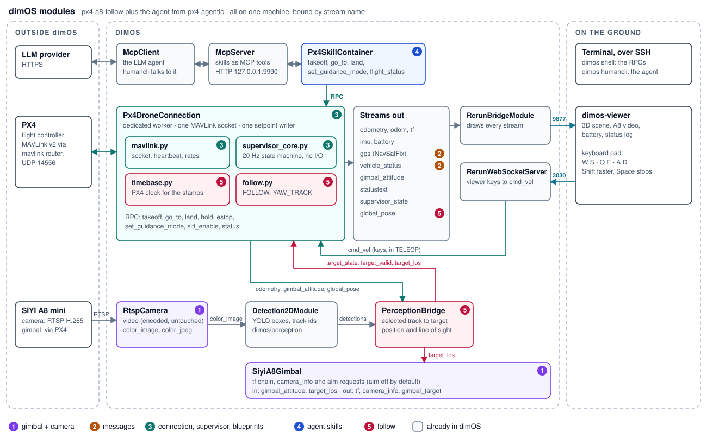

# PX4 drone

dimOS flies a PX4 multicopter over MAVLink Offboard: takeoff, go-to, land, keyboard teleop,
agent skills and following a detected target. The RC pilot can take over at any time.

## Setups

| Setup | Hardware | Blueprints |
|---|---|---|
| No hardware | PX4 SITL (`make px4_sitl gz_x500`) and QGroundControl | `px4-sitl`, `px4-sitl-agentic`, `px4-sitl-follow` |
| Bare kit | a PX4 multicopter with GPS, RC and a SiK telemetry radio; dimOS on a laptop | `px4`, `px4-agentic`, with `--px4droneconnection.link=radio` |
| Companion computer | the same plus a computer on PX4 TELEM2 | `px4`, `px4-agentic` |
| Gimbal camera | plus a SIYI A8 mini on the companion computer | `px4-a8`, `px4-a8-follow` |

## System

- mavlink-router owns the link to PX4. It gives dimOS one UDP endpoint (14556) and
  QGroundControl another (14550), so the two never fight over a port.
- dimOS runs on one machine. Its topics and RPCs stay there; only the viewer (Rerun gRPC
  9877, keys on WebSocket 3030) and SSH cross the link.
- The RC link goes straight to PX4, not through dimOS.

## Modules

- `Px4DroneConnection` is the only module that talks to PX4: one MAVLink socket and one
  setpoint writer, enforced by a lock on UDP 5610.
- Its supervisor (`supervisor_core.py`, no I/O) runs at 20 Hz and streams Offboard
  setpoints: `IDLE > PREFLIGHT > STREAMING > OFFBOARD_REQ > ARMING > TAKEOFF > HOVER >
  LANDING`. From `HOVER` the operator selects `GOTO`, `TELEOP`, `FOLLOW` or `YAW_TRACK`.
- Commands are RPCs on the connection; the agent's skills call the same RPCs. There is no
  arm, mode or raw-setpoint RPC.
- Every other module is optional and binds to the connection's streams by name.

## Safety

- When PX4 leaves Offboard (the pilot took over, or a PX4 failsafe), the supervisor stops
  streaming and never sends a mode command.
- An RC enable switch (channel 7) gates every takeoff. Switching it off in flight aborts to
  Hold.
- Preflight: 3D fix with `h_acc` under 1.5 m, a valid position estimate, battery at 40 % or
  more, disarmed, on the ground. Fence 30 m, ceiling 15 m.
- If dimOS stops, the setpoints stop and PX4's Offboard-loss failsafe takes over.

## Code

The numbers match the module diagram.

| # | Part | Where |
|---|---|---|
| 1 | SIYI A8 gimbal, RTSP camera | `dimos/hardware/gimbal/siyi`, `dimos/hardware/sensors/camera/rtsp` |
| 2 | `NavSatFix`, `px4_msgs.VehicleStatus` | `dimos/msgs` |
| 3 | connection, supervisor, `px4`, `px4-sitl`, `px4-a8` | `dimos/robot/px4` |
| 4 | agent skills, `px4-agentic`, `px4-sitl-agentic` | `dimos/robot/px4/skill_container.py`, `dimos/robot/px4/blueprints/agentic` |
| 5 | vehicle clock, geolocation, `PerceptionBridge`, `FOLLOW` and `YAW_TRACK`, `px4-a8-follow`, `px4-sitl-follow` | `dimos/robot/px4`, `dimos/perception/geolocation` |

Setup, commands and tests: `dimos/robot/px4/README.md`.
