# Distributed Dimensional

Run one blueprint across several machines: the robot's drivers on its Jetson, a mapper on a GPU box, the viewer on your laptop.

## WARNING: dimos host is essentially remote code execution

Dimos RPC is pickle for now, and a fragment is a pickled blueprint. Anyone who can reach a
Host's router can make it run any code they like, as the user the Host runs as. There is no
authentication or encryption yet.

- A Host listens only on its own machine until you open it with `listen=`.
- Open it only on networks you trust: ideally a VPN such as Tailscale
  (`dimos host config listen=iface/tailscale0`).

## TL;DR

On every machine, in a checkout of the same commit:

```sh
dimos host config listen=iface/tailscale0 connect=tcp/100.64.0.2:7447    # reachable on tailscale, linked to one other Host
dimos host install --start                                               # a systemd service, started now and at login
dimos host doctor                                                        # checks the setup; --fix repairs what it can
```

`connect` names any one Host already set up; Hosts tell each other about the rest. Then on your
machine, [write a distributed blueprint](/docs/usage/distributed/blueprints.md) and run it:

```sh
dimos host ls                  # the Hosts this one can see
dimos run go2-nav-hosted       # Ctrl-C stops every fragment
```

Linking, autodiscovery and gossip are in [How Hosts find each other](#how-hosts-find-each-other);
commands and settings in [`dimos host`](/docs/usage/distributed/cli.md).

# Detailed intro

## Concepts

- **Dimos Host**: a machine running `dimos host start`. Hosts link to each other by address,
  or find each other if you let them. Each carries tags, detected or your own (`gpu`, `go2`,
  ...), that a blueprint chooses Hosts by, and its code revision.
- **Blueprint root**: the `dimos run` you type. It places modules on Hosts, sends each its
  fragment, streams their logs back, and keeps the run alive while it runs.
- **Fragment**: the part of a blueprint placed on one Host: its modules, their config, and
  references to modules on other Hosts. The Host runs it like any local `dimos run`.
- **Run**: one launch of a distributed blueprint, one fragment per Host, sharing a run id.

<details>
<summary>diagram source</summary>

```pikchr fold output=../assets/distributed_run.svg
color = white
fill = none
boxrad = 6px

# laptop on top, the other two Hosts below: every Host links to every other
L: box wid 1.6in ht 1.4in
text "laptop: Host" at L.n + (0, 0.15in)
C: box "blueprint root" "dimos run ..." fit wid 140% ht 140% at L.c + (0, 0.3in)
V: box "viewer" "fragment" fit wid 140% ht 140% at L.c + (0, -0.35in)
arrow dashed from C.s to V.n

J: box wid 1.6in ht 1.4in at L.c + (-2.3in, -2.2in)
text "Jetson: Host" at J.s + (0, -0.15in)
JF: box "go2 nav" "fragment" fit wid 140% ht 140% at J.c

G: box wid 1.6in ht 1.4in at L.c + (2.3in, -2.2in)
text "GPU box: Host" at G.s + (0, -0.15in)
GF: box "mesher" "fragment" fit wid 140% ht 140% at G.c

arrow <-> from J.ne to L.sw "zenoh" aligned above
arrow <-> from L.se to G.nw "zenoh" aligned above
arrow <-> from J.e to G.w "zenoh" above

# the blueprint root's fragments, straight into each Host's fragment
arrow <- dashed from JF.n to C.w "fragment" aligned above
arrow dashed from C.e to GF.n "fragment" aligned above
```

</details>



## How Hosts find each other

Hosts link to the addresses you give them, and to the Hosts those know of: if A links to B
and B to C, A and C link too (gossip; `dimos host config gossip=false` keeps to the links you
name).

With autodiscovery on, Hosts listening on a LAN that carries multicast also scout each other on
their own group (`224.0.0.224:7449`) and link. Anyone on that network can join, so keep it for
networks you trust:

```sh
dimos host config autodiscovery=true     # false turns it back off
dimos host restart
```

Otherwise, link Hosts by address. Only the machines others dial need to listen on the
network; a laptop that only dials out can stay on its own machine:

```sh
# GPU box, 10.0.0.20, and the Go2's Jetson, 10.0.0.30: listen on the network
dimos host install --start --config listen=tcp/0.0.0.0

# laptop: dial both, listen nowhere else
dimos host install --start --config connect=tcp/10.0.0.20:7447,tcp/10.0.0.30:7447
dimos host ls                    # laptop, GPU box, Jetson
dimos run go2-nav-hosted
```

On a Host already running, `dimos host config connect=...` then `dimos host restart`. One side
of each link is enough, either direction. Zenoh keeps redialing, so the order Hosts come up in
does not matter. With gossip on, linking the laptop to one of them is enough once those two
are linked.

## Same code everywhere

A Host only takes fragments built from its own code revision: the git commit, plus a hash of
uncommitted changes. `dimos host ls` flags a Host on another revision.

To bring them in line, commit and push here, then `dimos host sync`: every other Host fetches,
checks out your branch, fast-forwards to your commit and restarts into it. A Host running a
fragment, or whose checkout git refuses to move, says so and stays as it is.

## Configuration

Each fragment's config is, last wins:

1. the Host's own environment and `.env` (device IPs, `n_workers`, GPU settings)
2. the blueprint root's config file and CLI flags
3. pinned settings are zenoh as the transport, run's own domain, local modules using local Host's router

So per-machine settings live in that machine's `.env`, and what you pass to `dimos run`
reaches every fragment.

## Isolation and lifetime

Every stream of a run lives under `dimos-domains/<run id>/`, so runs sharing a network never
cross. The same isolation is available to any run with `--zenoh-domain <name>`.

Fragments stop when the blueprint root exits. If the blueprint root dies or drops off the network,
each Host stops its fragments after 30 s (`HOST__RUN_LOSS_GRACE`).
