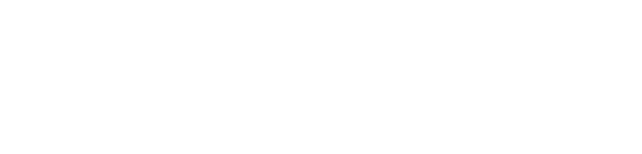

# Transforms

A transform maps points from a child frame into a parent frame. For example,
`world -> base_link -> camera_optical` describes the camera pose in the world.
Camera intrinsics convert pixels and depth into camera-frame points; this frame
chain then places those points in the robot or world frame.



The CDR proposal uses generated `TransformStamped`, `PoseStamped` and
`TFMessage` values from `dimos.messages`. Frame names and source time live in
`header.frame_id` and `header.stamp`; the destination frame is `child_frame_id`.
Geometry operations live in `dimos.msgs.geometry`.

## Define a mount

`frames_to_edge_transforms` converts frame specifications into generated values.
Each specification contains a frame name, parent name, translation in meters,
and fixed-axis XYZ roll/pitch/yaw in radians. A parent of `None` marks the root.

```python
from dimos.protocol.tf.static_tf_publisher import frames_to_edge_transforms

edges = frames_to_edge_transforms([
    ("world", None, (0, 0, 0), (0, 0, 0)),
    ("base_link", "world", (1, 0, 0), (0, 0, 0)),
    ("camera_optical", "base_link", (0.5, 0, 0.3), (0, 0, 0)),
])
assert edges[0].header.frame_id == "world"
assert edges[1].child_frame_id == "camera_optical"
```

These definitions have zero timestamps. `StaticTFPublisher` publishes configured
mounts repeatedly with a fresh timestamp, so late subscribers and recorders
receive them.

## Compose and invert

Compose connected edges in parent-to-child order. Inversion swaps the frames.

```python
from dimos.msgs.geometry import compose_transforms, inverse_transform
from dimos.protocol.tf.static_tf_publisher import frames_to_edge_transforms

first, second = frames_to_edge_transforms([
    ("base_link", "world", (1, 0, 0), (0, 0, 0)),
    ("camera_optical", "base_link", (0.5, 0, 0.3), (0, 0, 0)),
])
world_camera = compose_transforms(first, second)
assert world_camera.transform.translation.x == 1.5
camera_world = inverse_transform(world_camera)
assert camera_world.header.frame_id == "camera_optical"
assert camera_world.child_frame_id == "world"
```

Use `transform_matrix(value.transform)` for a homogeneous NumPy matrix and
`pose_from_transform(value)` for a generated `PoseStamped`.

## Query a frame chain

`MultiTBuffer` keeps recent samples for each parent/child pair. `get()` resolves
forward or inverse edges and composes the shortest available chain. It returns
`None` when no eligible chain is available.

```python
from dimos.protocol.tf.static_tf_publisher import frames_to_edge_transforms
from dimos.protocol.tf.tf import MultiTBuffer

buffer = MultiTBuffer()
buffer.receive_transform(*frames_to_edge_transforms([
    ("base_link", "world", (1, 0, 0), (0, 0, 0)),
    ("camera_optical", "base_link", (0.5, 0, 0.3), (0, 0, 0)),
]))
pose = buffer.get_pose("world", "camera_optical")
assert pose is not None
assert pose.pose.position.x == 1.5
```

Pass `time_point` and `time_tolerance` in seconds to select the nearest sample.
`forward_tolerance` bounds how long a lookup waits for a missing sample or chain.
The time index retains integer source nanoseconds and owns its snapshots; the
existing query arguments remain seconds.

## Attach a stream

`TF(stream)` subscribes to `TFMessage` values and exposes the same lookups.
`publish()` updates its local graph and publishes the generated message through
that stream. With no stream, `TF()` is a local buffer.

This complete offline example uses the raw LCM in-process queue with CDR. The
transport owns the encoding; callers publish generated values.

```python
from contextlib import ExitStack

from dimos.core.cdr_transport import CdrTransport
from dimos.messages.tf2_msgs.msg import TFMessage
from dimos.protocol.tf.static_tf_publisher import frames_to_edge_transforms
from dimos.protocol.tf.tf import TF

with ExitStack() as cleanup:
    wire = CdrTransport("mounts", TFMessage, backend="lcm", url="memq://")
    cleanup.callback(wire.stop)
    sender, receiver = TF(wire), TF(wire)
    cleanup.callback(sender.dispose)
    cleanup.callback(receiver.dispose)
    sender.publish(*frames_to_edge_transforms([
        ("camera", "world", (1, 2, 3), (0, 0, 0)),
    ]))
    result = receiver.get("world", "camera", forward_tolerance=2.0)
    assert result is not None
    assert result.transform.translation.z == 3.0
```

Modules use the existing `tf: In[TFMessage]` or `tf: IO[TFMessage]` port and lazy
`module.tfbuffer` accessor after stream wiring. Select the proposal's explicit
CDR transport for generated ports until the default transport cutover is
complete. See [module composition](/docs/usage/modules.md) for deployment and
[recording generated CDR](/docs/development/cdr-recording.md) for storage.

## Query a recording

`StreamTF` uses the recording's typed TF stream with the same lookup arguments.
The generated stream selects the CDR codec through normal mem2 configuration.

```python
from dimos.memory.store.memory import MemoryStore
from dimos.memory.tf import StreamTF
from dimos.messages.tf2_msgs.msg import TFMessage
from dimos.protocol.tf.static_tf_publisher import frames_to_edge_transforms

with MemoryStore() as store:
    stream = store.stream("tf", TFMessage)
    edges = frames_to_edge_transforms([
        ("camera", "world", (1, 2, 3), (0, 0, 0)),
    ])
    stream.append(TFMessage(transforms=edges), ts=0.0, pose=None)
    result = StreamTF(stream).get("world", "camera", time_point=0.0)
    assert result is not None
    assert result.transform.translation.y == 2.0
```

SQLite and MCAP retain the same generated message fields and complete dependency
schemas. Historical LCM recordings need explicit conversion; this guide does
not provide automatic legacy decoding.

For frame conventions, see [ROS REP 103](https://www.ros.org/reps/rep-0103.html)
and [ROS REP 105](https://www.ros.org/reps/rep-0105.html).
